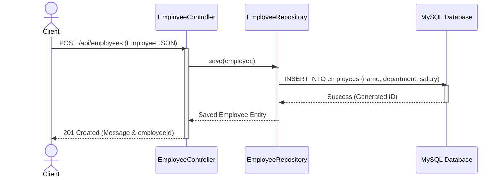
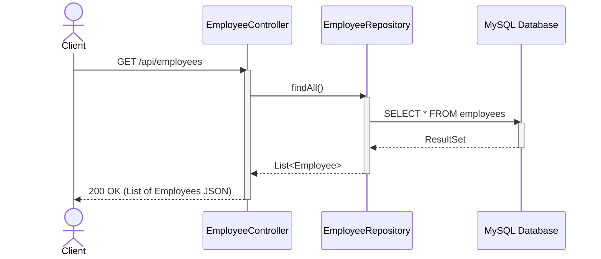
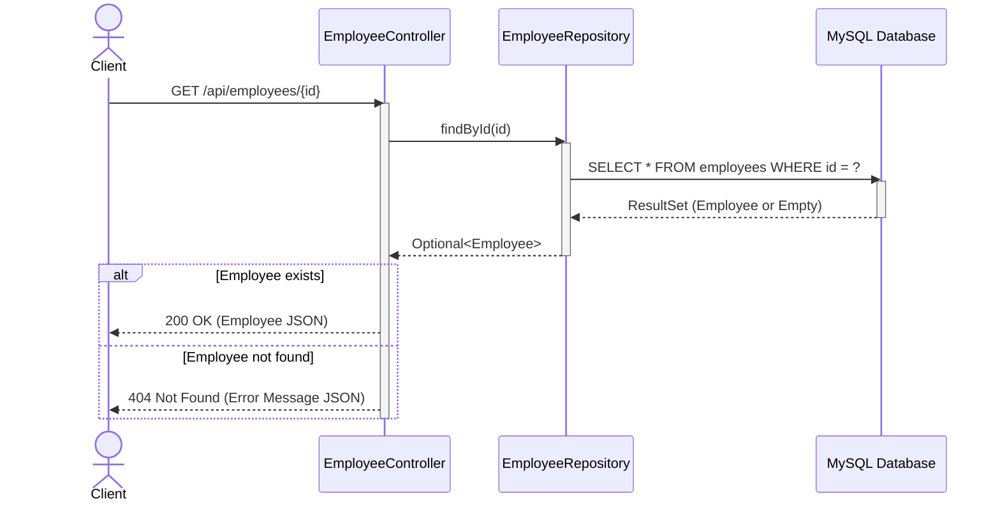
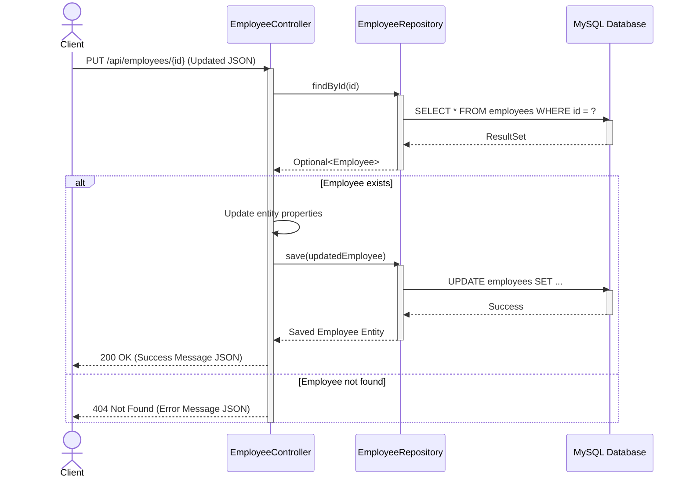
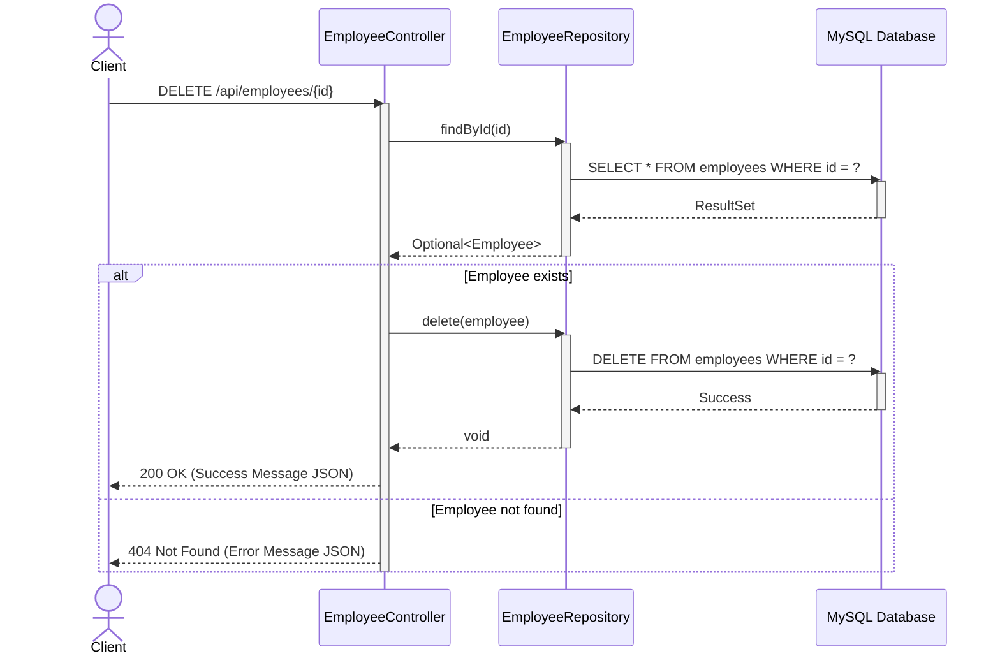

# Employee Management Fullstack Application

This project features a frontend and a backend API for managing employees. The backend has been converted to **Java Spring Boot** and uses **MySQL** as its database. 

## Getting Started

### Prerequisites
- Java 17+
- Maven
- MySQL Server

### Running the Backend

1. Open a terminal and navigate to the `backend` directory.
2. Ensure your MySQL server is running and a database named `company` exists. You may configure the DB user/password in `backend/src/main/resources/application.properties`.
3. Run the Spring Boot application using Maven:
   ```bash
   cd backend
   mvn spring-boot:run
   ```
4. The backend will start on `http://localhost:3000`.

## API CRUD Operations Sequence Diagrams

Below are the detailed sequence diagrams illustrating the data flow across the Spring Boot components (Client -> Controller -> Repository -> Database) for every operation.

### 1. Create (POST `/api/employees`)



### 2. Read All (GET `/api/employees`)



### 3. Read by ID (GET `/api/employees/{id}`)



### 4. Update (PUT `/api/employees/{id}`)



### 5. Delete (DELETE `/api/employees/{id}`)


